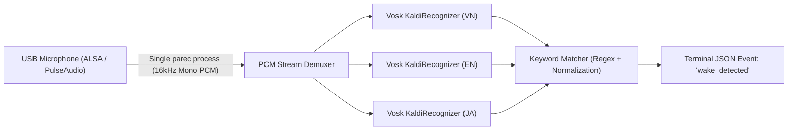

# Wake Word Phase 1: Self-Contained Module

Module thử nghiệm nhận diện cùng một Wake Word **Maica** qua ba ngôn ngữ, sử dụng 3 mô hình ASR **Vosk** nhỏ, hoạt động offline 100% trên thiết bị biên (Jetson Orin Nano / Ubuntu x86_64).

> [!NOTE]
> Đây là giai đoạn 1 (Phase 1 Baseline): Sử dụng ASR keyword matching trên luồng PCM liên tục. Đây **chưa phải** mô hình Keyword Spotting (KWS) chuyên dụng được huấn luyện riêng.

| ID | Keyword | Ngôn ngữ | Pretrained Model |
|---|---|---|---|
| `vi_maica` | Maica | Tiếng Việt | `vosk-model-small-vn-0.4` |
| `en_maica` | Maica | Tiếng Anh | `vosk-model-small-en-us-0.15` |
| `ja_maica` | Maica / まいか | Tiếng Nhật | `vosk-model-small-ja-0.22` |

---

## A. Kiến trúc kỹ thuật (Architecture)



- **Một luồng capture duy nhất:** Chỉ chạy đúng 1 tiến trình `parec` lấy mẫu 16 kHz 16-bit mono PCM. Cả 3 Recognizer đọc chung các khối PCM (3200 bytes / 100ms).
- Không xung đột microphone với hệ thống.
- Độc lập 100% với ROS 2, VoiceController và Kiosk production.

---

## B. Cài đặt môi trường (Installation)

### 1. Cài đặt Python Virtual Environment & Dependencies
Chạy từ bất kỳ thư mục nào:
```bash
cd src/robot_ui/wakeupword
bash install.sh
```
Script sẽ tự động:
- Kiểm tra Python >= 3.10 và hệ điều hành.
- Tạo virtual environment độc lập tại `~/.venvs/souta-wakeword`.
- Cài đặt `vosk==0.3.45` từ PyPI (hỗ trợ cả x86_64 và aarch64).
- Kiểm tra các công cụ hệ thống `parec`, `pactl`.

### 2. Tải 3 Pretrained Models
Mặc định tải và giải nén an toàn vào `~/vosk-models`:
```bash
~/.venvs/souta-wakeword/bin/python download_models.py
```
*(Nếu thư mục model đã tồn tại và hợp lệ, script sẽ tự động bỏ qua mà không tải lại).*

---

## C. Hướng dẫn chạy thử (Quick Start)

### 1. Lắng nghe trực tiếp (Live Mode)
```bash
bash run.sh live
```
Khi nói **Maica**, terminal xuất event nếu một trong các Vosk model nhận đúng. Các model có thể phiên âm tên riêng khác đi; đây chưa phải detector đã được kiểm chứng:
```json
{"event": "wake_detected", "keyword": "maica", "detector": "vi_maica", "timestamp": "2026-11-12T06:00:00"}
```

### 2. Thu âm mẫu WAV phục vụ đánh giá (Record Mode)
```bash
bash run.sh record --output samples/test_vi.wav --duration 4
```

### 3. Đánh giá offline tập mẫu (Evaluate Mode)
Tạo file `manifest.csv` cục bộ:
```csv
file,expected
samples/test_vi.wav,vi_maica
samples/negative_01.wav,none
```
Chạy đánh giá:
```bash
bash run.sh evaluate --manifest manifest.csv --report results.json
```

---

## D. Chẩn đoán & Gỡ lỗi (Debug)

Nếu không nhận diện được từ khóa, bật chế độ debug transcript:
```bash
bash run.sh live --debug-transcripts --debug-partials
```
- `asr_final`: Hiển thị văn bản do từng recognizer chốt sau khoảng lặng.
- `asr_partial`: Hiển thị từ khóa đang nhận diện dở dang.

Kiểm tra microphone PulseAudio:
```bash
pactl get-default-source
pactl list short sources
```

---

## E. Kiểm thử (Unit Tests)
Chạy toàn bộ unit tests độc lập (không cần model, mic hay mạng):
```bash
python3 -m unittest discover -s tests -v
```

Kiểm tra smoke test nạp model thực tế:
```bash
~/.venvs/souta-wakeword/bin/python -m unittest tests/smoke_test_models.py -v
```

---

## F. Giới hạn kỹ thuật & Định hướng Phase 2
1. **Giới hạn:** Vosk ASR cần một khoảng lặng nhỏ để kết thúc câu (final segment), do đó độ trễ phản hồi (latency) cao hơn KWS chuyên dụng.
2. **Phase 2:**
   - Kết hợp mô hình VAD (Voice Activity Detector) siêu nhẹ để chỉ decode khi có tiếng nói người.
   - Xây dựng cơ chế IPC / Socket nhẹ nhàng chuyển tiếp tín hiệu Wake Word vào `VoiceController` mà không gây chiếm giữ luồng capture mic.

## G. Wake Word hiện tại

Tên robot trong Kiosk vẫn là Souta. Trong thí nghiệm này chỉ **đổi câu đánh thức thành Maica** (một từ cho tất cả ngôn ngữ), ba recognizer vẫn chạy để kiểm tra cách model tiếng Việt, tiếng Anh và tiếng Nhật nhận cùng từ. Keyword canonical trong event là `maica`, trường `detector` ghi rõ model nào nhận được.

Đối với ASR pretrained, Maica có thể bị nhận sai thành từ khác hoặc không có trong từ vựng; trước khi mở rộng alias, kiểm tra `--debug-transcripts --debug-partials` và ghi lại false positives. Không suy diễn việc đổi tên sẽ tự làm tăng tỷ lệ phát hiện.
